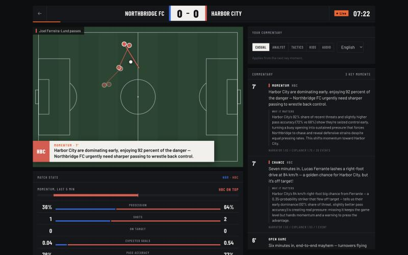
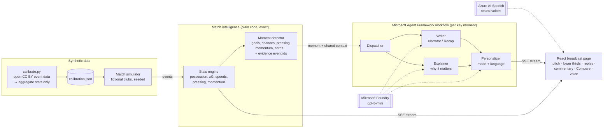

# Match Brain

**Explainable, multi-agent match intelligence for football broadcasts.** Match Brain plays synthetic, football-realistic matches and turns every pass, shot, tackle and pressing spell into live commentary that explains *why* a moment matters, told the way each viewer wants it: casual fan, analyst, coach, child, or blind and low-vision fan, in English, Spanish, Hindi or Nepali.

Built for the Microsoft x Premier League **Inside the Game: Developer Hackathon** (challenge: *The Synthetic Match Insights Engine for Premier League Studio*).

**Live demo:** https://matchbrain.orangefield-a516b99c.westus2.azurecontainerapps.io



> Synthetic data only. Every match is generated from scratch between fictional clubs; no real Premier League match data is used.

## What it does

| Brief stage | How Match Brain does it |
|---|---|
| **Ingest** synthetic events | A calibrated simulator streams a full 90-minute match: passes, carries, shots, tackles, pressure, possession changes, fouls, cards |
| **Interpret** into stats | A stats engine computes exact live numbers: possession, xG, pass accuracy, pass and shot speed, pressing rate, momentum over the last 5 minutes |
| **Explain** why it matters | A moment detector flags ~29 key moments per match; an Explainer agent says why each one matters (control vs chaos, pressure, rhythm, game state) |
| **Render** alongside the match | A broadcast-style page: score bug, live pitch with pass trails, TV lower-third graphics, commentary timeline, replays of key moments |
| **Personalize** for every fan | 5 viewing modes x 4 languages, switchable mid-match; spoken commentary; "Compare" shows one moment told five ways |

## Architecture



Everything runs as one container on **Azure Container Apps**, which authenticates to Foundry and Speech with a **managed identity** (no keys in the cloud).

## The agents

For every key moment, a **Microsoft Agent Framework** workflow ([`agents/pipeline.py`](backend/agents/pipeline.py)) runs four agents on **Microsoft Foundry**:

| Agent | Role | Runs |
|---|---|---|
| **Narrator** | One live commentary line, varied from its previous lines | every moment (in parallel with the Explainer) |
| **Recap** | Half-time and full-time summary of the story so far | at half-time and full-time, instead of the Narrator |
| **Explainer** | Why the moment matters, grounded in the recent state of the game and the evidence events | goals, big chances, momentum shifts, pressing, chaotic spells |
| **Personalizer** | Rewrites both for the viewer's mode and language | when the viewer is not on the default (Casual, English) |

Design choices:

- **Agents never compute numbers.** The stats engine does the maths; agents only explain and narrate the facts they are given, and are instructed never to add players, stats or events.
- **Traceable.** Every moment lists the event ids it is based on, and every commentary card shows which agents worked on it and how long each took.
- **Shared state.** All agents get the same match context: score and minute, the last five minutes in plain words, an evidence summary, the story so far.
- **Fails gracefully.** Each step has a fallback (template line, rule-based explanation, unpersonalized text) and a timeout, so a slow or failing model degrades the output instead of stopping the broadcast.
- **Parallel where possible.** Writer and Explainer run side by side (fan-out); the Personalizer waits for both (fan-in). A typical moment takes 2–4 seconds end to end.

## Personalization

| Mode | For | Style |
|---|---|---|
| Casual | most fans | the story, no statistics except the score |
| Analyst | data lovers | 2–3 precise numbers and what they mean |
| Tactics | coaches | shape, space, pressing, decisions |
| Kids | children | very short, excited sentences |
| Described | blind and low-vision fans | who has the ball, where on the pitch, what happened, then the score; written to be read aloud |

Languages: English, Spanish, Hindi, Nepali (player and team names stay as written). Switching re-tells the latest moments straight away, **Voice** reads commentary aloud with Azure AI Speech neural voices in the chosen language, and **Compare** shows any moment in all five modes side by side.

## Synthetic match data

[`generator/`](backend/generator) simulates full 90-minute matches between fictional clubs. The event schema and pitch coordinates are documented in [`events.py`](backend/generator/events.py); the same seed always produces the same match, and goals can be scripted for demos.

The simulator is **calibrated, not copied**: [`tools/calibrate.py`](backend/tools/calibrate.py) measures aggregate patterns (pass length mix, failure rates near goal and when challenged, shot conversion by distance, header rates, duel, foul and card rates) and saves them to [`calibration.json`](backend/generator/calibration.json). What the source data does not record (carries, pressing frequency, shot technique, deflections, ball and shot speed) is set by hand and listed under `assumptions` in that file.

| Per match | Real (World Cup 2018 + Euro 2016) | Simulated (average of 20) |
|---|---|---|
| Passes | 863 | 979 |
| Pass accuracy | 85% | 85% |
| Shots | 22.8 | 22.0 |
| Goals | 1.9 | 2.2 |
| Ground duels | 126 | 143 |
| Fouls | 27 | 30 |

**Calibration data.** Aggregate statistics only, from the public Wyscout soccer-logs dataset (World Cup 2018 and Euro 2016; no Premier League data), licensed [CC BY 4.0](https://creativecommons.org/licenses/by/4.0/):

> Pappalardo, L., Cintia, P., Rossi, A. et al. A public data set of spatio-temporal match events in soccer competitions. *Scientific Data* 6, 236 (2019). https://doi.org/10.1038/s41597-019-0247-7 — data: https://figshare.com/collections/Soccer_match_event_dataset/4415000

No real match events are included in this repository.

## Microsoft and Azure services

| Service | Used for |
|---|---|
| **Microsoft Foundry** (gpt-5-mini) | All four agents |
| **Microsoft Agent Framework** | Agents and the fan-out / fan-in workflow |
| **Azure AI Speech** | Spoken commentary in four languages |
| **Azure Container Apps** | Hosting (scales to zero when idle) |
| **Azure Container Registry** | Container images |
| **Managed identity + Azure RBAC** | Keyless access to Foundry and Speech (Foundry User role) and to the registry (AcrPull) |

## Run locally

Backend (http://localhost:8000):

```bash
cd backend
python3 -m venv .venv && source .venv/bin/activate
pip install -r requirements.txt
cp .env.example .env   # add FOUNDRY_API_KEY, or set FOUNDRY_AUTH=identity after `az login`
uvicorn app.main:app --reload --port 8000 --timeout-graceful-shutdown 3
```

Frontend (http://localhost:5173, proxies `/api` to the backend):

```bash
cd frontend
npm install
npm run dev
```

Without a model configured, the app still runs: commentary falls back to template lines.

Other tools (from `backend/`):

```bash
python -m generator.replay --seed 7 --speed 30                                   # watch a match in the terminal
python -m generator.match_sim --seed 7 --goal 23:home --goal 78:away:30 --out match.json  # export a match
```

## Deploy

The one-time setup (resource group, Foundry resource with a `gpt-5-mini` deployment, container registry, Container Apps environment, app with a system-assigned identity holding the *Foundry User* role) is listed at the top of [`deploy.sh`](deploy.sh). After that, every release is:

```bash
./deploy.sh
```

It builds the image locally (free-trial subscriptions cannot run cloud builds), pushes it to the registry and rolls it out.

## Project layout

```
backend/
  app/          FastAPI: live SSE stream, re-tell and speech endpoints
  agents/       Narrator, Explainer, Recap, Personalizer and the workflow
  engine/       stats engine and moment detector
  generator/    event schema, fictional teams, simulator, terminal replay
  tools/        calibration from open event data
frontend/src/   React + TypeScript broadcast page
Dockerfile      one container: built frontend + backend
deploy.sh       build, push and roll out to Azure Container Apps
```
