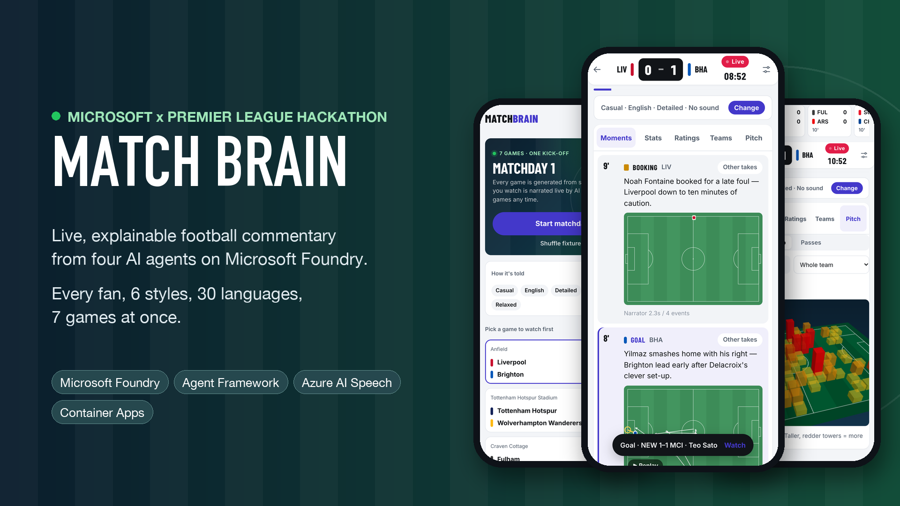
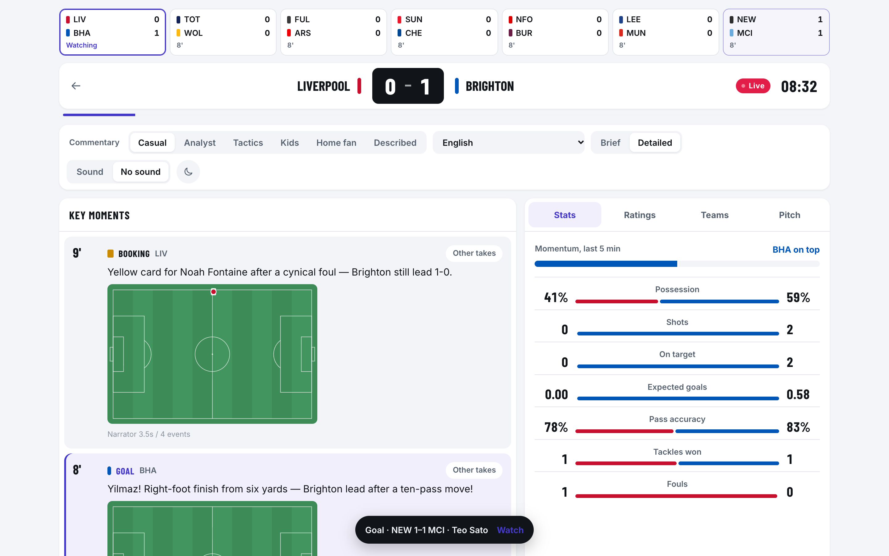
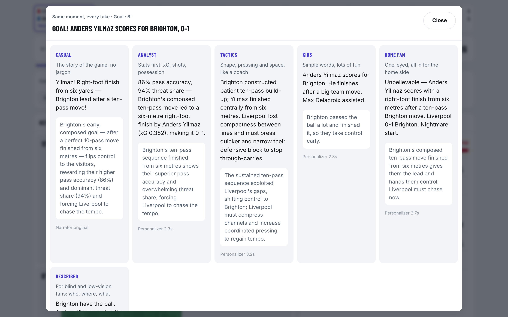
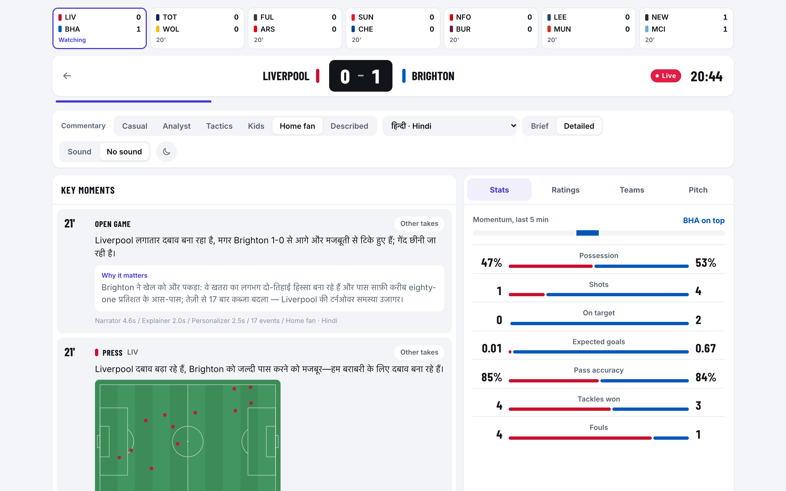
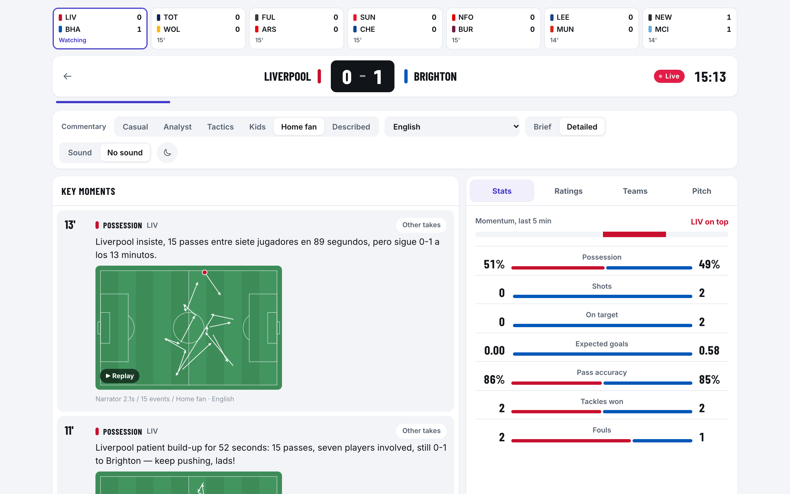
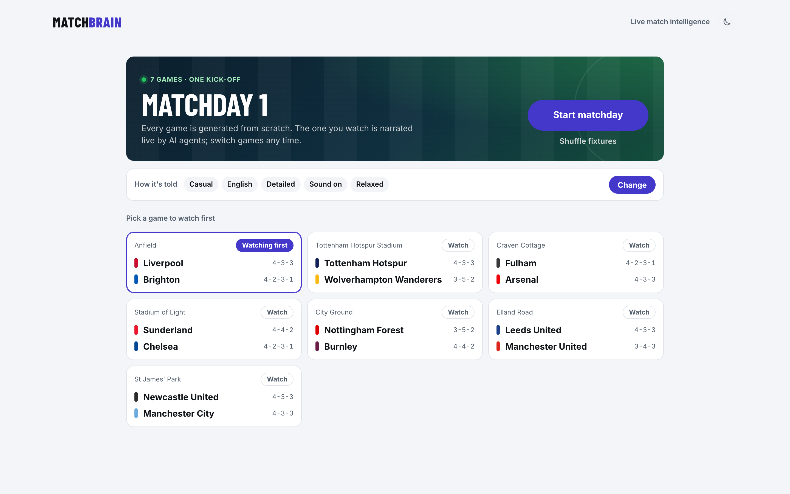
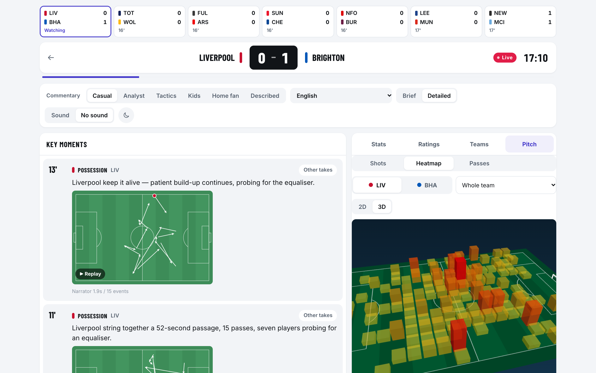
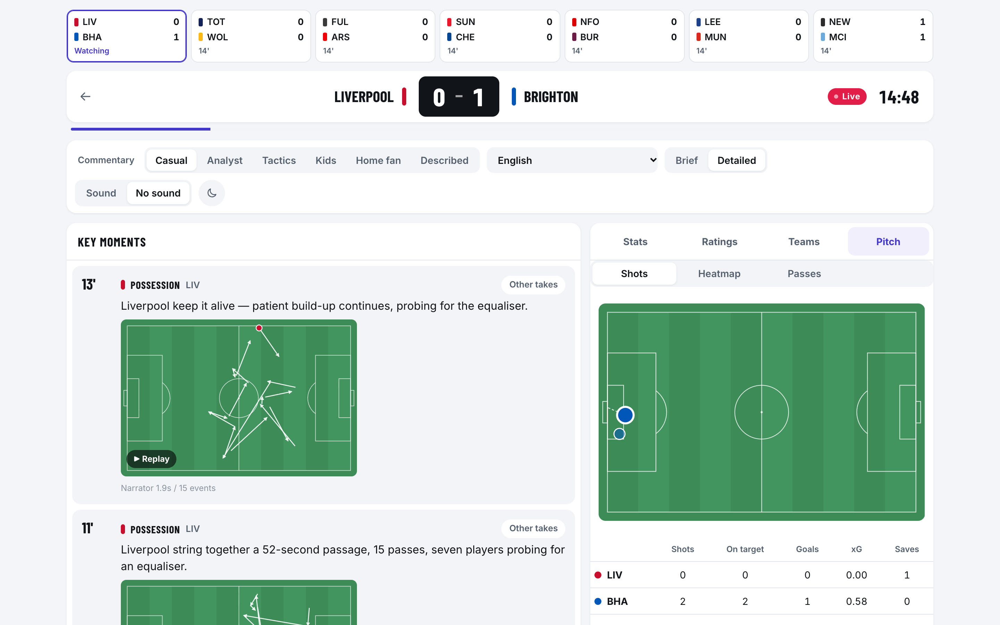
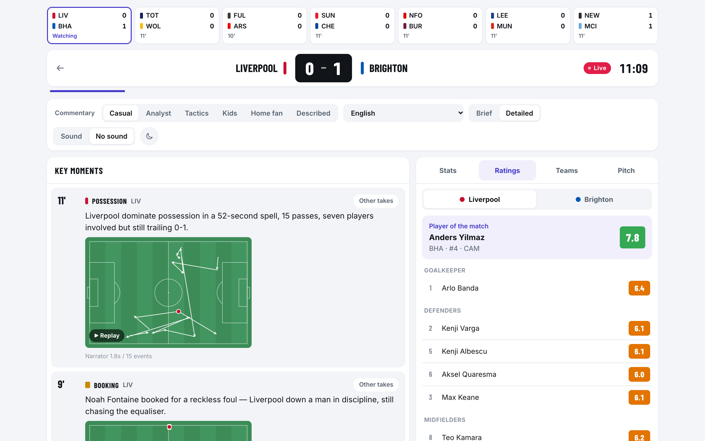
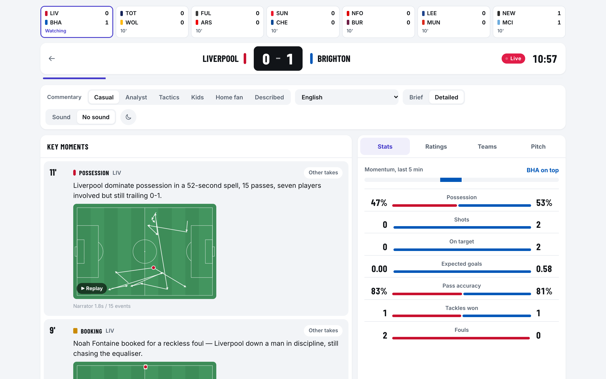

# Match Brain gallery

Screenshots used on the hackathon project page, captured from the live app on 27 October 2026.

**Demo video:** https://youtu.be/6avQoBMw2qs

| Image | What it shows |
|---|---|
|  | Cover: matchday start page, a live goal card and the 3D heatmap on phones |
|  | Live game: scores ticker for all seven games, a goal with a picture of the move, live stats and a goal alert from another game |
|  | "Other takes": the same goal told in all six commentary styles |
|  | Commentary and "why it matters" in Hindi, with the agents behind each line |
|  | Home fan: one-eyed commentary for the home side |
|  | Matchday start page: seven fixtures, one kick-off |
|  | 3D heatmap of where a team has had the ball |
|  | Shot map with shots, on target, goals, xG and saves |
|  | Live player ratings and player of the match |
|  | Live match stats: momentum, possession, shots, xG, pass accuracy |

`process/` holds design feedback from building it (an early, annotated screenshot of the old setup page).
